  

 

# Awesome DevOps 🚀🛠️

**A definitive, SEO-optimized, production-ready directory of enterprise DevOps SaaS solutions, CI/CD pipelines, GitOps workflows, Infrastructure as Code (IaC), cloud-native platforms, and top-starred open-source developer tooling.**

[Sector Overview](#-sector-overview--market-dynamics) • [Enterprise SaaS Solutions](#-enterprise-saas-devops-platforms) • [Open-Source Solutions](#-ranked-open-source-devops-tools) • [Contributing](#-contributing) • [Support](#-support) • [Star History](#-star-history) • [License](#-license)

---

## 🌟 Overview & SEO Highlights

**Awesome DevOps** provides developers, Site Reliability Engineers (SREs), DevOps architects, platform engineers, and engineering managers with an authoritative index of industry-leading **DevOps tools**, **CI/CD platforms**, **Infrastructure as Code (IaC)** engines, and **cloud-native observability stacks**. 

Whether designing multi-tenant enterprise deployment pipelines, automating GitOps rollouts on Kubernetes clusters, or provisioning hybrid cloud infrastructure, choosing the right toolchain requires clear insights into total cost of ownership. This curated benchmark breaks down **enterprise SaaS unit pricing**, **exact free tier thresholds & trial quotas**, and **company scale (valuation/revenue)**, alongside battle-tested, **community-ranked open-source alternatives** sorted by real-time GitHub_Stars.

---

## 📊 Sector Overview & Market Dynamics

The global DevOps software and platform market is valued at approximately **$14.8 billion in 2026** and is projected to expand to **$37.5 billion by 2031**, progressing at a compound annual growth rate (CAGR) of **~20.5%**. The sector demonstrates a **moderately fragmented, hub-and-spoke competitive dynamic**: a handful of hyperscale enterprise titans—namely **Microsoft (GitHub & Azure DevOps)**, **GitLab**, and **Atlassian**—anchor the end-to-end consolidated platform segment ("all-in-one developer platforms"), while a vibrant, highly innovative layer of specialized best-of-breed vendors (such as **Harness**, **CircleCI**, **Octopus Deploy**, and **HashiCorp**) continuously capture high-value enterprise niches across continuous delivery, continuous verification, release orchestration, and deployment automation.

---

## 🏢 Enterprise SaaS DevOps Platforms

The following enterprise SaaS platforms provide developer platforms, continuous integration, continuous delivery (CI/CD), software delivery lifecycle (SDLC) management, and release automation. The table is ranked by **Company Scale (Valuation / Revenue)** in descending order, with explicit verified starting prices and exact free tier limits.

| Product | Company Valuation / Revenue | Pricing (Starting Tier) | Free Tier / Trial Limits | Description |
| :--- | :--- | :--- | :--- | :--- |
| [**Microsoft Azure DevOps**](https://azure.microsoft.com/en-us/products/devops/) | **$3.1+ Trillion Market Cap** (Microsoft) | **$6.00 / user / month** (Basic Plan for users 6+, includes Boards, Repos, Pipelines, and Artifacts) | **Free Forever**: First 5 users free forever with Azure Boards, Repos, 1 free Microsoft-hosted CI/CD pipeline job (up to 1,800 minutes/month), 1 self-hosted concurrent job with unlimited minutes, and 2 GB free Azure Artifacts storage. | Comprehensive enterprise DevOps suite tightly integrated with Microsoft cloud ecosystems, offering agile planning, Git repos, test management, and flexible build/deploy pipelines. |
| [**GitHub Enterprise & Actions**](https://github.com/pricing) | **$100+ Billion Valuation** (Subsidiary of Microsoft; $1B+ ARR) | **$21.00 / user / month** (billed annually for GitHub Enterprise Cloud; or $4.00 / user / month for GitHub Team) | **Free Forever**: Unlimited public & private repositories, 2,000 CI/CD Actions minutes/month for standard Linux runners, and 500 MB GitHub Packages storage for personal/free accounts. | The world's largest developer platform and source code repository, featuring GitHub Actions CI/CD workflows, automated security scanning (Dependabot), code review, and Codespaces. |
| [**Atlassian Jira Software**](https://www.atlassian.com/software/jira/pricing) | **$45+ Billion Market Cap** (Atlassian Corporation; $4.4B+ ARR) | **$7.91 / user / month** (Standard plan, billed monthly, or $790/year for 10 users) | **Free Forever**: Up to 10 users, 2 GB file storage, unlimited Scrum and Kanban project boards, backlog planning, and standard automation workflows (up to 100 rule runs/month). | The industry benchmark for issue tracking, agile sprint planning, and DevOps release management, bridging engineering code commits with enterprise project tracking. |
| [**GitLab SaaS**](https://about.gitlab.com/pricing/) | **$8.5+ Billion Market Cap** (NASDAQ: GTLB; ~$700M+ ARR) | **$29.00 / user / month** (Premium plan, billed annually at $348/year; Ultimate plan at $99.00/user/month) | **Free Forever**: 1 user per namespace, 400 CI/CD compute minutes/month, 5 GB storage, 10 GB transfer per month, and complete core Git repo & issue tracking capabilities. | Complete DevSecOps single application unifying source code management, built-in CI/CD pipelines, container registry, dynamic security scanning, and compliance governance. |
| [**Harness Continuous Delivery**](https://www.harness.io/pricing) | **$3.7+ Billion Valuation** (Privately held unicorn; Series D) | **$100.00 / Harness Service Unit (HSU) / month** (Team plan starting price with automated canary/blue-green deployments) | **Free Forever & 14-Day Enterprise Trial**: Free tier includes 100 deployments/month, 3 service instances, and 1 continuous delivery pipeline. Free 14-day fully featured Enterprise cloud trial without credit card. | Intelligent, AI-native continuous delivery and software delivery platform featuring continuous deployment, chaos engineering, cloud cost management, and automated rollbacks. |
| [**CircleCI**](https://circleci.com/pricing/) | **$1.7+ Billion Valuation** (Privately held unicorn; Series F) | **$15.00 / month** (Scale/Performance starting tier includes 3 users and 25,000 monthly compute credits, then $0.0006 per additional credit) | **Free Forever**: 6,000 build credits/month (equivalent to ~600 build minutes on standard 2-vCPU medium Linux compute resources), up to 30 concurrent jobs, and unlimited users. | Cloud-native continuous integration and delivery platform optimizing build speed with advanced docker caching, machine runners, and reusable configuration orbs. |
| [**Octopus Deploy**](https://octopus.com/pricing) | **$1.0+ Billion Valuation** (Bootstrapped unicorn / Insight Partners; $70M+ ARR) | **$12.00 / target / month** (Standard Cloud tier, billed annually with a 10-target minimum starting at $120/month) | **30-Day Free Trial**: 30-day unrestricted free trial with up to 10 deployment targets, unlimited users, multi-tenant deployment support, and runbook automation (no credit card required). | Automated release management and deployment orchestration server designed to automate complex microservices and enterprise deployments across multi-cloud and on-premise environments. |

---

## ⚡ Ranked Open-Source DevOps Tools

The following production-grade open-source DevOps projects, cloud-native engines, and CI/CD tools are **strictly sorted by GitHub Stargazers in descending order**. Click on any Stars_Badge to view real-time repository stargazer metrics.

| Project | GitHub_Stars | Primary Category | Description |
| :--- | :--- | :--- | :--- |
| [**Kubernetes**](https://github.com/kubernetes/kubernetes) |  | Container Orchestration (Go) | Production-grade container scheduling and orchestration platform automating deployment, scaling, and operational management of containerized applications across compute clusters. |
| [**Grafana**](https://github.com/grafana/grafana) |  | Observability & Visualization (TypeScript / Go) | The open and composable observability and interactive data visualization platform. Connects to Prometheus, Loki, Elasticsearch, InfluxDB, PostgreSQL, and cloud backends. |
| [**Ansible**](https://github.com/ansible/ansible) |  | Configuration Management (Python) | Radically simple, agentless IT automation and configuration management platform automating cloud provisioning, configuration management, and application deployment via YAML playbooks over SSH. |
| [**Prometheus**](https://github.com/prometheus/prometheus) |  | Metrics & Alerting (Go) | Cloud Native Computing Foundation (CNCF) graduated systems monitoring and time-series database toolkit featuring high-performance multi-dimensional metrics scraping and PromQL querying. |
| [**Traefik**](https://github.com/traefik/traefik) |  | Edge Router & Ingress (Go) | Modern HTTP reverse proxy and ingress controller designed for microservices and containers, offering automatic dynamic configuration discovery with zero downtime. |
| [**Terraform**](https://github.com/hashicorp/terraform) |  | Infrastructure as Code (Go) | Industry-standard declarative Infrastructure as Code (IaC) tool enabling engineers to safely and predictably codify, provision, and version multi-cloud architecture and APIs. |
| [**Docker Compose**](https://github.com/docker/compose) |  | Local Container Stacks (Go) | Multi-container application orchestrator allowing teams to define, configure, and isolate entire microservice environments using straightforward declarative YAML files. |
| [**Istio**](https://github.com/istio/istio) |  | Service Mesh (Go) | Open platform to connect, manage, secure, and monitor microservices across cloud clusters, providing zero-trust mTLS encryption, advanced traffic routing, and telemetry tracing. |
| [**Helm**](https://github.com/helm/helm) |  | Kubernetes Package Management (Go) | The canonical package manager for Kubernetes; simplifies defining, versioning, installing, upgrading, and managing complex Kubernetes application chart deployments. |
| [**Harbor**](https://github.com/goharbor/harbor) |  | Artifact & Container Registry (Go) | CNCF graduated open-source trusted cloud-native artifact registry that stores, signs, scans container images for vulnerabilities, and enforces role-based identity policies. |
| [**Jenkins**](https://github.com/jenkinsci/jenkins) |  | CI/CD Automation Server (Java) | The extensible, battle-tested open-source automation server with thousands of ecosystem plugins powering building, testing, and continuous delivery pipelines across enterprises globally. |
| [**Argo CD**](https://github.com/argoproj/argo-cd) |  | GitOps Continuous Delivery (Go) | CNCF graduated declarative GitOps continuous delivery tool for Kubernetes, continuously reconciling desired application states specified in Git repositories with live cluster state. |
| [**Tekton Pipelines**](https://github.com/tektoncd/pipeline) |  | Cloud-Native CI/CD (Go) | Flexible, cloud-native CI/CD framework under the Continuous Delivery Foundation (CDF) providing reusable Kubernetes-native CRDs (Tasks and Pipelines) to construct bespoke build engines. |
| [**Flux CD**](https://github.com/fluxcd/flux2) |  | GitOps Toolkit (Go) | CNCF graduated continuous delivery tool suite keeping Kubernetes clusters in sync with configuration sources (Git, OCI repositories, S3 buckets) and automating image update rollouts. |
| [**OpenTelemetry Collector**](https://github.com/open-telemetry/opentelemetry-collector) |  | Telemetry Ingestion & Export (Go) | High-performance, vendor-neutral telemetry proxy and collector for receiving, processing, transforming, and exporting distributed traces, application metrics, and log telemetry. |

---

## 🤝 Contributing

Contributions are warmly welcomed! 💖

1. 🍴 **Fork** the repository.
2. 🌿 **Create** a descriptive feature branch (`git checkout -b feature/add-devops-platform`).
3. 📝 **Add** your entry with specific starting tier pricing and verified free tier limits (for SaaS) or GitHub Stars_Count badges (for Open Source).
4. ✅ **Ensure** proper formatting, chronological star sorting, and markdown link integrity.
5. 🚀 **Submit** a pull request!

---

## 💖 Support

If you find this repository valuable for your DevOps architectures, infrastructure modernization, or cloud pipelines, thank you for supporting the project! You can show your appreciation in several ways:

- ⭐ **Star this repository** to help others discover it on GitHub.
- 🍴 **Fork and contribute** new DevOps platforms, tooling benchmarks, and ecosystem updates.
- 📢 **Share it** with fellow DevOps engineers, SREs, and cloud architects.
- ☕ **Buy me a coffee / Sponsor:** Support ongoing research and curation directly via the [GitHub Sponsors Dashboard](https://github.com/sponsors/ishandutta2007).

  

---

##  Star History

---

## 📄 License

This repository is distributed under the [MIT License](LICENSE).

 

  Built with ❤️ by <a href="https://github.com/ishandutta2007">Ishan Dutta</a> and the open-source community.

